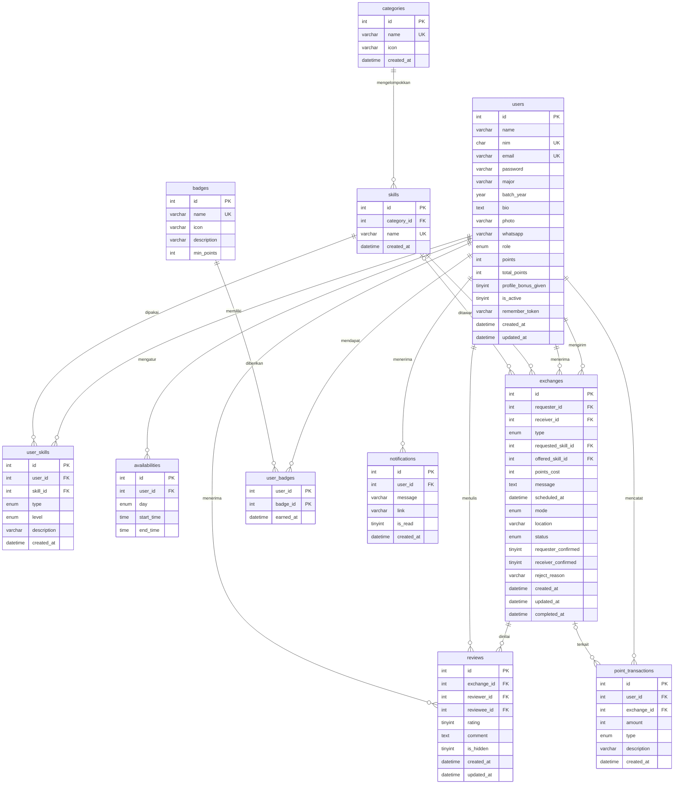
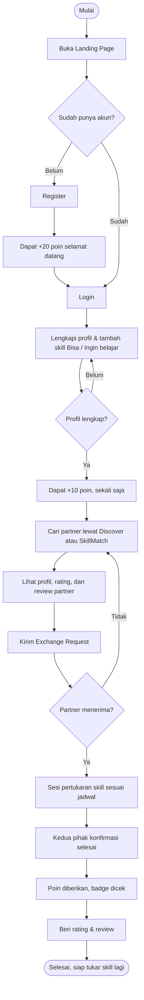
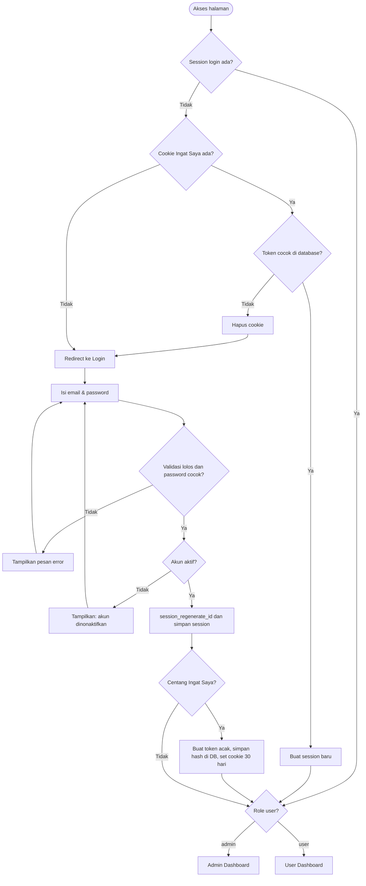
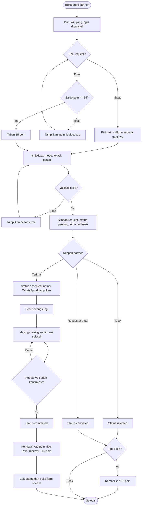
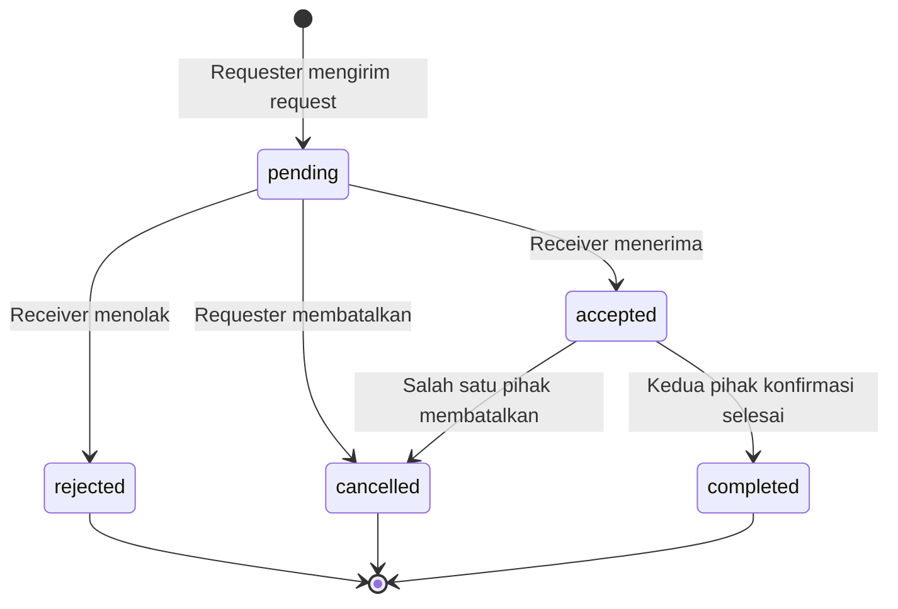
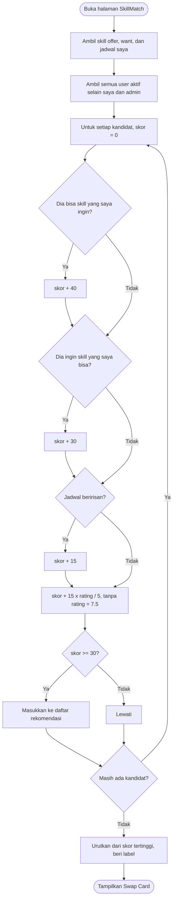
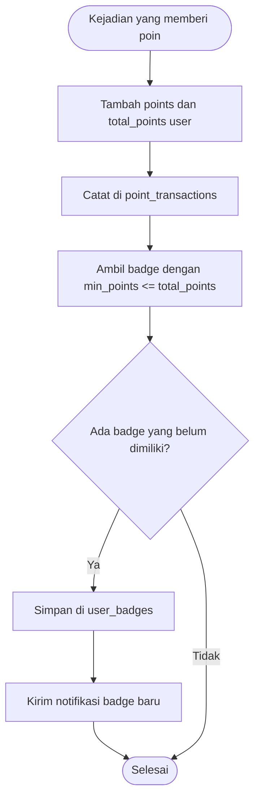
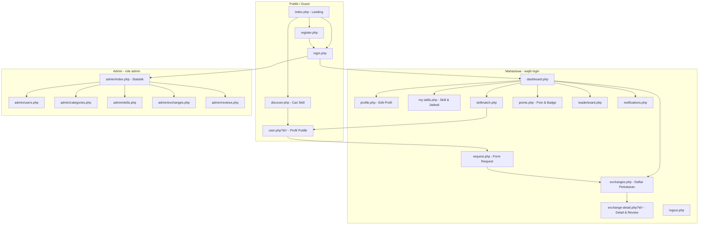

# TukarSkill — System Design

> **Tukar Skill. Dapat Skill.**
> Kelompok 3 · COSC6050 Programming for Business · Final Project
> SDG utama: **SDG 4 – Quality Education** · SDG pendukung: **SDG 10**, **SDG 8**

| Anggota | NIM |
|---|---|
| Jennifer Lovinda Tampinongkol | 2902662860 |
| Liftya Muthi Pradipta | 2902666165 |
| Lucky Fadlan Kusuma Anggoro | 2902656750 |
| Rangga Alrasya Nazriel Alamsyah | 2902691122 |
| Revano Hartojo | 2902703734 |

**Isi dokumen**
1. Ringkasan Sistem & Aktor
2. Daftar Fitur
3. Aturan Bisnis (Business Rules)
4. ERD
5. Data Dictionary
6. Flowchart
7. Page Map
8. Wireframe Notes
9. Design System
10. Struktur Folder & Teknologi

> Diagram di dokumen ini ditulis dengan Mermaid. Buka `docs/diagrams.html` di browser untuk melihat semua diagram dan mengunduhnya sebagai **PNG/SVG** untuk laporan.

---

## 1. Ringkasan Sistem & Aktor

TukarSkill adalah platform web pertukaran skill antar mahasiswa. Alur utamanya:

**Create Profile → Add Skills → Discover → Match → Request → Exchange → Complete → Review**

| Aktor | Deskripsi | Hak akses |
|---|---|---|
| **Guest** | Pengunjung yang belum login | Melihat landing page, Discover, dan profil publik; register & login |
| **Mahasiswa (User)** | Pengguna terdaftar | Semua fitur pertukaran skill: profil, skill, SkillMatch, request, review, poin |
| **Admin** | Pengelola platform | Dashboard statistik, kelola user, kategori & katalog skill, pantau pertukaran, moderasi review |

---

## 2. Daftar Fitur

### Fitur inti (7)

| Kode | Fitur | Deskripsi | Operasi |
|---|---|---|---|
| **F1** | Skill Profile | Mengelola skill yang **Bisa** diajarkan (`offer`) dan **Ingin dipelajari** (`want`) beserta level, deskripsi, dan jadwal ketersediaan mingguan | CRUD `user_skills`, `availabilities` |
| **F2** | Discover | Mencari mahasiswa berdasarkan nama/skill; filter kategori, level, dan hari tersedia | Read + filter (`$_GET`) |
| **F3** | SkillMatch | Rekomendasi partner dengan skor kecocokan 0–100% (saling melengkapi, jadwal, reputasi) | Read (query + perhitungan skor) |
| **F4** | Exchange Request | Request pertukaran (**Swap** skill ↔ skill atau **Poin** satu arah), terima/tolak, batalkan, konfirmasi selesai | Create, Update status, Delete (batal) |
| **F5** | Trust & Reputation | Rating 1–5 ★ dan review setelah pertukaran selesai; rata-rata rating di profil | CRUD `reviews` |
| **F6** | Skill Points & Badge | Riwayat poin, badge otomatis (🌱 Bibit, 🌿 Tunas, 🌳 Pohon, 🏆 Mentor), leaderboard | Insert log, Read |
| **F7** | Admin Panel | Statistik, kelola user, CRUD kategori & skill, pantau pertukaran, moderasi review | Full CRUD |

### Fitur pendukung
- **Autentikasi**: register (validasi server-side), login, logout, `password_hash()` / `password_verify()`
- **Session & Cookie**: login berbasis session, cookie **"Ingat Saya"** (token, 30 hari), role guard untuk halaman admin
- **Dashboard**: ringkasan poin, badge, request masuk, jadwal terdekat, top 3 SkillMatch
- **Notifikasi**: notifikasi request baru dan perubahan status
- **Pesan error & flash message**: error di bawah tiap field + notifikasi sukses/gagal

### Fitur opsional (Phase AI)
- **AI Session Planner**: membuat rencana belajar singkat untuk pertukaran yang sudah diterima. Akan diputuskan nanti (API atau tidak).

---

## 3. Aturan Bisnis (Business Rules)

### 3.1 Akun & Profil
| Kode | Aturan |
|---|---|
| BR-01 | Email dan NIM harus unik. NIM 10 digit angka. Password minimal 8 karakter dan harus sama dengan konfirmasi. |
| BR-02 | Password disimpan dengan `password_hash()` (bcrypt). |
| BR-03 | User nonaktif (`is_active = 0`) tidak bisa login dan tidak muncul di Discover/SkillMatch. |
| BR-04 | Profil dianggap **lengkap** jika punya bio, minimal 1 skill `offer`, dan minimal 1 skill `want`. |
| BR-05 | Foto profil hanya JPG/PNG/WEBP, maksimal 2 MB, disimpan dengan nama acak. |
| BR-06 | Nomor WhatsApp partner hanya ditampilkan setelah request berstatus `accepted`. |

### 3.2 Skill & Jadwal
| Kode | Aturan |
|---|---|
| BR-07 | Skill dipilih dari katalog yang dikelola admin. Satu user tidak bisa menambahkan skill yang sama dua kali pada tipe yang sama. |
| BR-08 | Level skill: `pemula`, `menengah`, `mahir`. |
| BR-09 | Jadwal ketersediaan: hari + jam mulai + jam selesai (jam selesai > jam mulai). |

### 3.3 Exchange Request
| Kode | Aturan |
|---|---|
| BR-10 | Ada dua tipe request: **Swap** (requester mengajarkan satu skill miliknya sebagai gantinya) dan **Poin** (requester membayar **15 poin**, tanpa mengajar balik). |
| BR-11 | Skill yang diminta harus ada di daftar `offer` milik receiver. Untuk Swap, skill pengganti harus ada di daftar `offer` milik requester. |
| BR-12 | Tidak bisa request ke diri sendiri. Tidak boleh ada lebih dari satu request aktif (`pending`/`accepted`) antara dua user yang sama untuk skill yang sama. |
| BR-13 | Request tipe Poin: saldo harus ≥ 15. Poin langsung **ditahan** (dikurangi) saat request dikirim, lalu **dikembalikan** jika request ditolak atau dibatalkan. |
| BR-14 | Hanya receiver yang bisa menerima/menolak. Requester bisa membatalkan selama `pending`. Setelah `accepted`, kedua pihak bisa membatalkan selama belum `completed`. |
| BR-15 | Konfirmasi selesai hanya bisa dilakukan setelah jadwal pertukaran lewat. Status menjadi `completed` hanya jika **kedua pihak** sudah konfirmasi. |

### 3.4 Review
| Kode | Aturan |
|---|---|
| BR-16 | Review hanya bisa diberikan untuk pertukaran `completed`, oleh peserta pertukaran tersebut, satu review per orang per pertukaran. |
| BR-17 | Penulis review bisa mengedit atau menghapus reviewnya. Admin bisa menyembunyikan review yang tidak pantas. |
| BR-18 | Rating profil = rata-rata rating dari review yang tidak disembunyikan. |

### 3.5 Skill Points & Badge
| Kode | Kejadian | Poin |
|---|---|---|
| BR-19 | Bonus selamat datang saat register | +20 |
| BR-20 | Profil lengkap (sekali saja) | +10 |
| BR-21 | Pertukaran selesai: setiap pihak yang **mengajar** | +20 |
| BR-22 | Request Poin selesai: receiver menerima poin yang ditahan | +15 |
| BR-23 | Memberi review | +5 |
| BR-24 | Menerima review bintang 5 | +10 |
| BR-25 | Mengirim request Poin (ditahan) / dikembalikan saat batal | −15 / +15 |

- `points` = **saldo** poin yang bisa dipakai.
- `total_points` = **total poin yang pernah didapat** (tidak berkurang saat dipakai). Badge ditentukan dari `total_points`, jadi badge tidak hilang saat poin dipakai.
- Setiap perubahan poin dicatat di tabel `point_transactions`.

| Badge | Syarat `total_points` |
|---|---|
| 🌱 Bibit | 0 |
| 🌿 Tunas | 50 |
| 🌳 Pohon | 150 |
| 🏆 Mentor | 300 |

### 3.6 SkillMatch — Rumus Skor (0–100)

| Komponen | Bobot | Kondisi |
|---|---|---|
| A. Dia bisa skill yang saya ingin pelajari | 40 | Ada minimal 1 skill `offer` dia yang ada di skill `want` saya |
| B. Dia ingin skill yang saya bisa | 30 | Ada minimal 1 skill `want` dia yang ada di skill `offer` saya |
| C. Jadwal cocok | 15 | Ada hari yang sama dengan jam yang beririsan |
| D. Reputasi | 15 | `15 × (rata-rata rating / 5)`; user tanpa rating mendapat 7,5 |

- Hanya ditampilkan jika A **atau** B terpenuhi (skor ≥ 30). User sendiri, admin, dan user nonaktif tidak ditampilkan.
- Label: **≥ 85 "Swap Sempurna"** (A dan B terpenuhi) · **≥ 70 "Sangat Cocok"** · **< 70 "Cocok"**.

---

## 4. ERD



**Kardinalitas utama**
- Satu **user** punya banyak **user_skills** (offer & want) dan banyak **availabilities**.
- Satu **category** punya banyak **skills**; satu **skill** bisa dimiliki banyak user (relasi many-to-many `users`–`skills` lewat `user_skills`).
- Satu **exchange** melibatkan dua user (requester & receiver), satu skill yang diminta, dan **nol atau satu** skill pengganti (kosong jika tipe Poin).
- Satu **exchange** punya maksimal **dua review** (satu dari tiap pihak).
- Relasi many-to-many `users`–`badges` lewat `user_badges`.

---

## 5. Data Dictionary

Database: `tukarskill` · Engine: InnoDB · Charset: `utf8mb4_unicode_ci`

### `users`
| Kolom | Tipe | Constraint | Keterangan |
|---|---|---|---|
| id | INT | PK, AUTO_INCREMENT | |
| name | VARCHAR(100) | NOT NULL | Nama lengkap |
| nim | CHAR(10) | NOT NULL, UNIQUE | NIM mahasiswa |
| email | VARCHAR(100) | NOT NULL, UNIQUE | |
| password | VARCHAR(255) | NOT NULL | Hash bcrypt |
| major | VARCHAR(100) | NOT NULL | Jurusan |
| batch_year | YEAR | NULL | Angkatan |
| bio | TEXT | NULL | |
| photo | VARCHAR(255) | NULL | Nama file di `uploads/avatars/` |
| whatsapp | VARCHAR(20) | NULL | Ditampilkan hanya ke partner yang `accepted` |
| role | ENUM('user','admin') | DEFAULT 'user' | |
| points | INT | DEFAULT 0 | Saldo poin |
| total_points | INT | DEFAULT 0 | Total poin yang pernah didapat (untuk badge) |
| profile_bonus_given | TINYINT(1) | DEFAULT 0 | Penanda bonus profil lengkap sudah diberikan |
| is_active | TINYINT(1) | DEFAULT 1 | |
| remember_token | VARCHAR(64) | NULL | Hash SHA-256 token "Ingat Saya" |
| created_at | DATETIME | DEFAULT CURRENT_TIMESTAMP | |
| updated_at | DATETIME | ON UPDATE CURRENT_TIMESTAMP | |

### `categories`
| Kolom | Tipe | Constraint | Keterangan |
|---|---|---|---|
| id | INT | PK, AUTO_INCREMENT | |
| name | VARCHAR(50) | NOT NULL, UNIQUE | Contoh: Programming, Desain, Bahasa |
| icon | VARCHAR(50) | NULL | Emoji / nama ikon |
| created_at | DATETIME | DEFAULT CURRENT_TIMESTAMP | |

### `skills`
| Kolom | Tipe | Constraint | Keterangan |
|---|---|---|---|
| id | INT | PK, AUTO_INCREMENT | |
| category_id | INT | FK → categories.id, ON DELETE RESTRICT | Kategori tidak bisa dihapus jika masih punya skill |
| name | VARCHAR(100) | NOT NULL, UNIQUE | Contoh: UI/UX Design, Bahasa Inggris |
| created_at | DATETIME | DEFAULT CURRENT_TIMESTAMP | |

### `user_skills`
| Kolom | Tipe | Constraint | Keterangan |
|---|---|---|---|
| id | INT | PK, AUTO_INCREMENT | |
| user_id | INT | FK → users.id, ON DELETE CASCADE | |
| skill_id | INT | FK → skills.id, ON DELETE CASCADE | |
| type | ENUM('offer','want') | NOT NULL | offer = Bisa, want = Ingin belajar |
| level | ENUM('pemula','menengah','mahir') | NOT NULL | Level yang dimiliki/dituju |
| description | VARCHAR(255) | NULL | Contoh: "Figma, prototyping, design system" |
| created_at | DATETIME | DEFAULT CURRENT_TIMESTAMP | |
| | | UNIQUE (user_id, skill_id, type) | BR-07 |

### `availabilities`
| Kolom | Tipe | Constraint | Keterangan |
|---|---|---|---|
| id | INT | PK, AUTO_INCREMENT | |
| user_id | INT | FK → users.id, ON DELETE CASCADE | |
| day | ENUM('senin','selasa','rabu','kamis','jumat','sabtu','minggu') | NOT NULL | |
| start_time | TIME | NOT NULL | |
| end_time | TIME | NOT NULL | Harus > start_time (validasi PHP) |

### `exchanges`
| Kolom | Tipe | Constraint | Keterangan |
|---|---|---|---|
| id | INT | PK, AUTO_INCREMENT | |
| requester_id | INT | FK → users.id | Pengirim request (yang ingin belajar) |
| receiver_id | INT | FK → users.id | Penerima request (yang mengajar) |
| type | ENUM('swap','points') | NOT NULL | Swap skill ↔ skill / bayar poin |
| requested_skill_id | INT | FK → skills.id | Skill yang ingin dipelajari requester |
| offered_skill_id | INT | FK → skills.id, NULL | Skill yang diajarkan balik (NULL jika type = points) |
| points_cost | INT | DEFAULT 0 | 15 jika type = points |
| message | TEXT | NULL | Pesan pengantar |
| scheduled_at | DATETIME | NOT NULL | Jadwal sesi yang diusulkan |
| mode | ENUM('online','offline') | NOT NULL | |
| location | VARCHAR(255) | NULL | Link meeting / lokasi kampus |
| status | ENUM('pending','accepted','rejected','cancelled','completed') | DEFAULT 'pending' | |
| requester_confirmed | TINYINT(1) | DEFAULT 0 | Konfirmasi selesai dari requester |
| receiver_confirmed | TINYINT(1) | DEFAULT 0 | Konfirmasi selesai dari receiver |
| reject_reason | VARCHAR(255) | NULL | Alasan penolakan/pembatalan |
| created_at | DATETIME | DEFAULT CURRENT_TIMESTAMP | |
| updated_at | DATETIME | ON UPDATE CURRENT_TIMESTAMP | |
| completed_at | DATETIME | NULL | |

### `reviews`
| Kolom | Tipe | Constraint | Keterangan |
|---|---|---|---|
| id | INT | PK, AUTO_INCREMENT | |
| exchange_id | INT | FK → exchanges.id, ON DELETE CASCADE | |
| reviewer_id | INT | FK → users.id | Penulis review |
| reviewee_id | INT | FK → users.id | Yang dinilai |
| rating | TINYINT | NOT NULL, 1–5 | |
| comment | TEXT | NULL | |
| is_hidden | TINYINT(1) | DEFAULT 0 | Disembunyikan admin |
| created_at | DATETIME | DEFAULT CURRENT_TIMESTAMP | |
| updated_at | DATETIME | ON UPDATE CURRENT_TIMESTAMP | |
| | | UNIQUE (exchange_id, reviewer_id) | BR-16 |

### `point_transactions`
| Kolom | Tipe | Constraint | Keterangan |
|---|---|---|---|
| id | INT | PK, AUTO_INCREMENT | |
| user_id | INT | FK → users.id, ON DELETE CASCADE | |
| exchange_id | INT | FK → exchanges.id, NULL, ON DELETE SET NULL | |
| amount | INT | NOT NULL | Positif = dapat, negatif = dipakai |
| type | ENUM('welcome','profile_complete','teach_complete','points_received','points_spent','points_refund','review_given','five_star','admin_adjust') | NOT NULL | |
| description | VARCHAR(255) | NOT NULL | Teks untuk Riwayat Poin |
| created_at | DATETIME | DEFAULT CURRENT_TIMESTAMP | |

### `badges`
| Kolom | Tipe | Constraint | Keterangan |
|---|---|---|---|
| id | INT | PK, AUTO_INCREMENT | |
| name | VARCHAR(50) | NOT NULL, UNIQUE | Bibit, Tunas, Pohon, Mentor |
| icon | VARCHAR(20) | NOT NULL | 🌱 🌿 🌳 🏆 |
| description | VARCHAR(255) | NULL | |
| min_points | INT | NOT NULL | Syarat total_points |

### `user_badges`
| Kolom | Tipe | Constraint | Keterangan |
|---|---|---|---|
| user_id | INT | PK, FK → users.id, ON DELETE CASCADE | |
| badge_id | INT | PK, FK → badges.id, ON DELETE CASCADE | |
| earned_at | DATETIME | DEFAULT CURRENT_TIMESTAMP | |

### `notifications`
| Kolom | Tipe | Constraint | Keterangan |
|---|---|---|---|
| id | INT | PK, AUTO_INCREMENT | |
| user_id | INT | FK → users.id, ON DELETE CASCADE | |
| message | VARCHAR(255) | NOT NULL | |
| link | VARCHAR(255) | NULL | Halaman tujuan saat diklik |
| is_read | TINYINT(1) | DEFAULT 0 | |
| created_at | DATETIME | DEFAULT CURRENT_TIMESTAMP | |

---

## 6. Flowchart

### 6.1 Alur Utama Pengguna



### 6.2 Register, Login & Role Check



### 6.3 Exchange Request (termasuk sistem poin)



### 6.4 Status Exchange (State Diagram)



### 6.5 Algoritma SkillMatch



### 6.6 Pemberian Poin & Badge



---

## 7. Page Map



### Daftar halaman

| Halaman | Akses | Fungsi | Fitur |
|---|---|---|---|
| `index.php` | Publik | Landing: hero, kategori, cara kerja, SkillMatch preview, skill populer, testimoni, FAQ, CTA | — |
| `register.php` | Guest | Form registrasi + validasi | Auth |
| `login.php` | Guest | Login + Ingat Saya | Auth |
| `logout.php` | User | Hapus session & cookie | Auth |
| `discover.php` | Publik | Cari & filter mahasiswa berdasarkan skill | F2 |
| `user.php?id=` | Publik | Profil publik: skill, jadwal, rating, review, badge, tombol Request | F2, F5 |
| `dashboard.php` | User | Ringkasan aktivitas | — |
| `profile.php` | User | Edit profil, foto, WhatsApp, ganti password | F1 |
| `my-skills.php` | User | CRUD skill Bisa / Ingin belajar + jadwal | F1 |
| `skillmatch.php` | User | Rekomendasi partner + skor | F3 |
| `request.php` | User | Form request Swap / Poin | F4 |
| `exchanges.php` | User | Tab: Masuk · Terkirim · Aktif · Riwayat | F4 |
| `exchange-detail.php?id=` | User (peserta) | Detail, timeline status, aksi, form review | F4, F5 |
| `points.php` | User | Saldo, riwayat poin, koleksi badge | F6 |
| `leaderboard.php` | User | Peringkat berdasarkan total poin | F6 |
| `notifications.php` | User | Daftar notifikasi | — |
| `admin/index.php` | Admin | Statistik platform | F7 |
| `admin/users.php` | Admin | Aktif/nonaktif, ubah role | F7 |
| `admin/categories.php` | Admin | CRUD kategori | F7 |
| `admin/skills.php` | Admin | CRUD katalog skill | F7 |
| `admin/exchanges.php` | Admin | Pantau semua pertukaran | F7 |
| `admin/reviews.php` | Admin | Sembunyikan / hapus review | F7 |

---

## 8. Wireframe Notes

### Landing (`index.php`)
1. **Navbar**: logo TukarSkill · Beranda · Cari Skill · Cara Kerja · FAQ · tombol pill putih **"Daftar ↗"**
2. **Hero** (gradien biru + cincin konsentris): chip "100% Gratis, Tanpa Biaya Kursus" · judul **"Tukar Skill. Dapat Skill."** · subjudul · search bar pill "Cari skill yang ingin kamu pelajari…" · foto mahasiswa di tengah · kartu melayang kiri **"4.8 ★ rating rata-rata"** · kartu melayang kanan avatar-stack **"500+ mahasiswa sudah bertukar"** · chip swap animasi `UI/UX ⇄ English`
3. **Kategori Skill**: grid kartu foto (Programming, Desain, Bahasa, Fotografi & Video, Public Speaking, Tutoring Matkul)
4. **Cara Kerja**: 4 langkah (Buat Profil → Temukan Partner → Tukar Skill → Beri Review)
5. **Masalah & Solusi**: kartu lime (Masalah) + kartu mint (Solusi), terinspirasi dari referensi
6. **SkillMatch Constellation**: "kamu" di tengah, avatar partner mengorbit dengan garis label skill
7. **Skill Paling Dicari**: chip filter kategori + kartu penawar skill (avatar, nama, level, rating, "Ingin belajar: …", tombol hitam "Ajak Tukar")
8. **Cerita Tukar**: testimoni
9. **FAQ**: accordion
10. **CTA**: "Siap tukar skill pertamamu?" + cincin konsentris
11. **Footer**: navy gelap, link, info SDG 4 / 10 / 8

### Dashboard (`dashboard.php`)
- Sapaan "Hai, {nama} 👋" + kartu saldo poin + badge saat ini + progress ke badge berikutnya
- Kartu statistik: Pertukaran selesai · Rating rata-rata · Request masuk
- "Jadwal Terdekat" (list) · "Rekomendasi SkillMatch" (3 Swap Card)
- Banner "Lengkapi profil untuk +10 poin" jika profil belum lengkap

### Discover (`discover.php`)
- Search bar + chip filter kategori + dropdown level & hari
- Grid kartu user: avatar, nama, jurusan, chip skill offer, rating, badge

### SkillMatch (`skillmatch.php`)
- Constellation kecil di atas + list **Swap Card**: avatar saya ⇄ avatar partner, "Kamu ajarkan: X · Kamu dapat: Y", ring skor %, label, tombol "Ajak Tukar"

### Exchange Detail (`exchange-detail.php`)
- Stepper status: Dikirim → Diterima → Sesi → Selesai → Review
- Info: tipe (Swap/Poin), skill, jadwal, mode, lokasi, kontak (jika accepted)
- Tombol aksi sesuai role dan status · form review (bintang + komentar)

---

## 9. Design System

Terinspirasi dari referensi *LearnNix E-learning UI/UX* (Behance), disesuaikan untuk identitas TukarSkill.

| Token | Nilai | Pemakaian |
|---|---|---|
| Font | **Inter** (Google Fonts) | Semua teks |
| `--blue-500` | `#3B82F6` | Warna utama, tombol primer, link |
| `--blue-600` | `#2563EB` | Hover, gradien hero bawah |
| `--blue-400` | `#4DA3FF` | Gradien hero atas |
| `--blue-50` | `#EEF5FF` | Background section |
| `--ink` | `#0B0B0F` | Teks utama, tombol hitam (CTA kartu) |
| `--gray` | `#94A3B8` | Teks sekunder, border |
| `--lime` | `#E8FB8C` | Kartu highlight (Masalah, poin) |
| `--mint` | `#DCEFD6` | Kartu highlight (Solusi, sukses) |
| `--star` | `#FFD43B` | Sparkle, rating bintang |
| `--white` | `#FFFFFF` | Kartu, navbar pill |
| Radius | 12 / 20 / 28 / 999px | Input / kartu / section / pill |
| Shadow | `0 10px 30px rgba(37,99,235,.10)` | Kartu melayang |

**Komponen**: tombol pill (biru, hitam, putih + ikon panah dalam lingkaran), chip filter, chip meta dengan ikon, kartu skill, Swap Card, ring skor, badge tier, stepper status, accordion FAQ, toast flash message, form field dengan error inline.

**Responsif**: desktop ≥ 1024px (grid 3 kolom), tablet 768px (2 kolom), mobile < 768px (1 kolom + menu hamburger).

---

## 10. Struktur Folder & Teknologi

```
pfbFinalLec/
├── config/
│   └── db.php                 # koneksi MySQLi
├── includes/
│   ├── header.php             # <head> + navbar
│   ├── footer.php             # footer + script
│   ├── auth.php               # cek session, cookie Ingat Saya, role guard
│   └── functions.php          # helper: escape, flash, csrf, poin, badge, notifikasi
├── assets/
│   ├── css/style.css
│   ├── js/script.js
│   └── img/
├── uploads/avatars/
├── admin/                     # halaman admin
├── database/
│   └── tukarskill.sql         # schema + seed data
├── docs/
│   ├── system-design.md       # dokumen ini
│   └── diagrams.html          # render & export diagram
└── *.php                      # halaman publik & user
```

| Lapisan | Teknologi |
|---|---|
| Frontend | HTML5, CSS3 (custom, tanpa framework), JavaScript (vanilla) |
| Backend | PHP 8.2 native (tanpa framework) |
| Database | MySQL / MariaDB via **MySQLi** (prepared statements) |
| Server lokal | XAMPP 8.2.12 |
| Editor | Visual Studio Code |

**Keamanan**: prepared statements di semua query · `htmlspecialchars()` untuk output · CSRF token di semua form POST · `password_hash` · `session_regenerate_id()` saat login · cookie `HttpOnly` · validasi tipe & ukuran upload · role guard.
